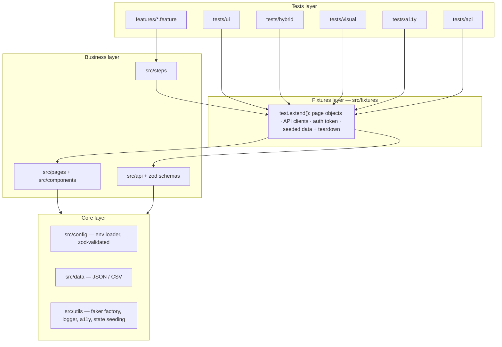

# Playwright Hybrid Test Automation Framework

[](https://github.com/prashanthv33/Test_Automation_Framework/actions/workflows/ci.yml)
[](https://github.com/prashanthv33/Test_Automation_Framework/actions/workflows/nightly.yml)
[](https://prashanthv33.github.io/Test_Automation_Framework/allure/)


[](LICENSE)

A production-style test automation framework built on **Playwright + TypeScript**. It combines five
kinds of testing on **one runner, one set of page objects and one set of fixtures**:

| Layer             | What it shows                                                              | Where                        |
| ----------------- | -------------------------------------------------------------------------- | ---------------------------- |
| **UI (E2E)**      | Page Object Model, reusable components, cross-browser + mobile             | `src/pages`, `tests/ui`      |
| **API**           | Typed API clients, zod contract validation, CRUD + negative tests          | `src/api`, `tests/api`       |
| **Hybrid**        | API + browser in one test, state seeding, network stubbing/fault injection | `tests/hybrid`               |
| **BDD**           | Gherkin features compiled to native Playwright tests (playwright-bdd)      | `features`, `src/steps`      |
| **Visual + a11y** | Screenshot regression with masking; axe-core WCAG 2.1 AA scans             | `tests/visual`, `tests/a11y` |

**Targets:** [SauceDemo](https://www.saucedemo.com) (web UI) and
[Restful-Booker](https://restful-booker.herokuapp.com) (REST API) — both public demo systems.

---

## Architecture



**Design rules**

1. **Tests never touch raw selectors or `request`.** They receive page objects and API clients from
   fixtures, so a UI change is fixed in one place.
2. **One fixture definition, two authoring styles.** `src/fixtures/index.ts` exports its fixture
   definitions as an object; the spec-style `test` and the BDD `test` are both built from it.
3. **Setup and teardown are fixtures.** `seededBooking` creates data via API and deletes it after
   the test — even when the test fails.
4. **Log in once.** A `setup` project logs in via the UI and saves `storageState`; every
   authenticated project depends on it.
5. **Fail fast on config.** Environment variables are validated with zod at startup.

## Project structure

```
├── .github/workflows/     ci.yml · nightly.yml · update-snapshots.yml
├── config/env/            .env.qa · .env.staging · .env.example
├── features/              Gherkin feature files
├── src/
│   ├── api/               ApiClient (base) · AuthClient · BookingClient · schemas/
│   ├── components/        HeaderComponent · ProductCard
│   ├── config/            env.ts (validated env) · constants.ts
│   ├── data/              users.json · products.json · checkout.csv
│   ├── fixtures/          custom Playwright fixtures (the framework's backbone)
│   ├── pages/             BasePage · LoginPage · InventoryPage · CartPage · Checkout*
│   ├── steps/             BDD step definitions
│   └── utils/             dataFactory (faker) · csvReader · appState · a11y · logger
├── tests/
│   ├── setup/             auth.setup.ts — log in once, save session
│   ├── ui/  api/  hybrid/  visual/  a11y/
├── Dockerfile
└── playwright.config.ts   projects: setup · chromium · firefox · webkit · mobile-chrome · api · bdd · visual · a11y
```

## Quick start

```bash
git clone https://github.com/prashanthv33/Test_Automation_Framework.git
cd Test_Automation_Framework
npm ci
npx playwright install --with-deps

npm run test:smoke        # fast confidence check (~1 min)
npm test                  # everything
npm run report            # open the Playwright HTML report
```

### Useful scripts

| Script                       | Purpose                                         |
| ---------------------------- | ----------------------------------------------- |
| `npm run test:smoke`         | `@smoke` tests on Chromium + API + BDD          |
| `npm run test:regression`    | everything tagged `@regression`                 |
| `npm run test:ui`            | UI + hybrid on Chromium, Firefox and WebKit     |
| `npm run test:mobile`        | smoke tests on a Pixel 7 viewport               |
| `npm run test:api`           | API tests only (no browser launched)            |
| `npm run test:bdd`           | generate + run Gherkin scenarios                |
| `npm run test:visual`        | visual regression                               |
| `npm run test:visual:update` | regenerate screenshots for your OS              |
| `npm run test:a11y`          | accessibility scans                             |
| `npm run test:staging`       | smoke suite against the staging config          |
| `npm run test:ui-mode`       | Playwright UI mode for interactive debugging    |
| `npm run report:allure`      | build and open the Allure report (needs Java)   |
| `npm run lint` / `typecheck` | static checks (also run by the pre-commit hook) |

### Environments

`TEST_ENV=qa|staging` selects `config/env/.env.<env>`. Values are resolved in this order:

1. real environment variables (CI secrets, shell exports)
2. `config/env/.env.local` (personal, git-ignored)
3. `config/env/.env.<TEST_ENV>` (committed defaults)

> The committed credentials are the **public** demo credentials published by SauceDemo and
> Restful-Booker. For a real system, keep secrets in GitHub Actions secrets only.

### Tags

Tests are tagged with `@smoke`, `@regression`, `@api`, `@hybrid`, `@visual` and `@a11y`.
Filter with Playwright's `--grep`, e.g. `npx playwright test --grep "@smoke" --grep-invert "@api"`.

## Highlights

**Data-driven tests** — one test per row, each reported separately:

```ts
for (const user of users.invalid) {
  test(`rejected login: ${user.description}`, async ({ loginPage }) => {
    await loginPage.login(user.username, user.password);
    await loginPage.expectError(user.error);
  });
}
```

**Fixture with automatic cleanup** — data is created through the API and always deleted:

```ts
seededBooking: async ({ bookingClient }, use) => {
  const created = await bookingClient.create(buildBooking());
  await use(created);
  await bookingClient.deleteRaw(created.bookingid);
},
```

**Contract testing** — every typed API call validates the response against a zod schema, so a
breaking API change fails with a precise message.

**Hybrid state seeding** — `seedCart(page, [...])` writes the cart straight into `localStorage`, so
a checkout test starts at checkout instead of clicking through six screens first.

**Network control** — tests block third-party telemetry, stub images with `route.fulfill`, and
check that the app still works when every image fails to load.

**BDD with no duplicate logic** — steps call the same page objects as the specs:

```gherkin
Scenario Outline: Login is rejected for <case>
  When I log in with username "<username>" and password "<password>"
  Then I should see the login error "<error>"
```

## CI/CD

| Workflow               | Trigger                  | What it does                                                                                     |
| ---------------------- | ------------------------ | ------------------------------------------------------------------------------------------------ |
| `ci.yml`               | push / PR to `main`      | lint, format check, typecheck → smoke suite; uploads the HTML report                             |
| `nightly.yml`          | 02:00 UTC daily + manual | all browsers × 4 shards + visual in Docker → merged HTML + Allure (with history) on GitHub Pages |
| `update-snapshots.yml` | manual                   | regenerates linux visual baselines in the Playwright image and commits them                      |

**Visual baselines are stored per platform** (`tests/visual/__screenshots__/<platform>/`) because
fonts render differently on each OS. Windows baselines are committed; after creating the GitHub repo,
run **Update visual baselines** once to add the linux set that CI compares against.

### GitHub setup checklist

1. Push to a new GitHub repository.
2. **Settings → Pages:** source = `gh-pages` branch (created by the first nightly run).
3. **Actions → Update visual baselines → Run workflow** (once).
4. Optional: add `UI_PASSWORD` / `API_PASSWORD` repository secrets to override the defaults.

## Docker

```bash
docker build -t pw-hybrid .
docker run --rm pw-hybrid                                   # full suite
docker run --rm pw-hybrid npx playwright test --project=api # one project
```

## Adding a test

See [docs/CONTRIBUTING.md](docs/CONTRIBUTING.md) for how to add a page object, an API client, a
BDD step or a new test.

## Tech stack

Playwright Test · TypeScript (strict) · playwright-bdd · zod · @faker-js/faker · @axe-core/playwright ·
allure-playwright · ESLint (typescript-eslint, eslint-plugin-playwright) · Prettier · Husky +
lint-staged · GitHub Actions · Docker
